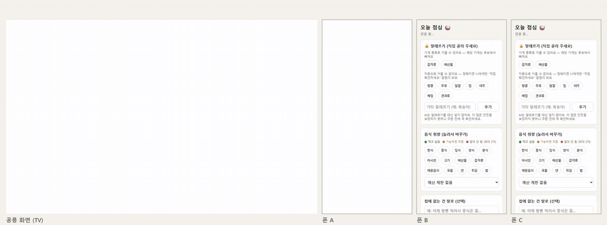
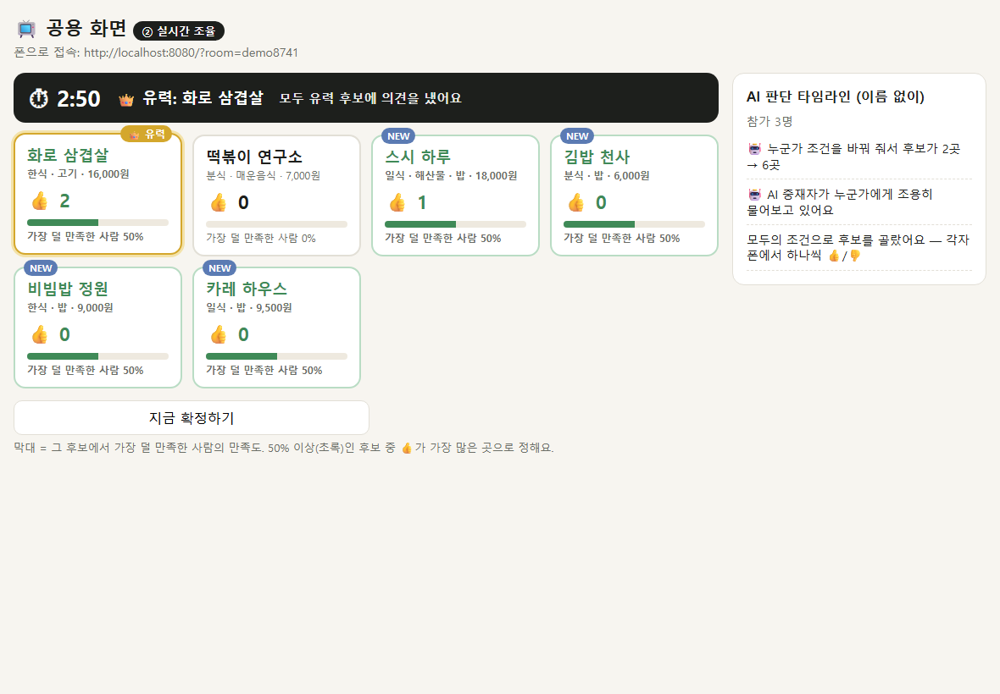
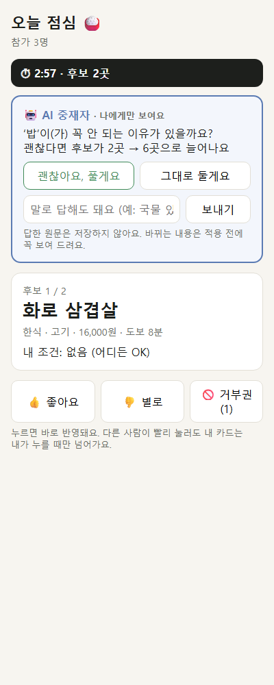
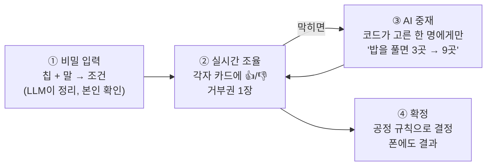

# 🤫 Quiet Consensus — 눈치 안 보는 실시간 합의 엔진

> 각자 **비밀로** 원하는 걸 넣으면, 모두가 보는 화면에서 "가장 덜 손해 보는 안"

https://github.com/user-attachments/assets/86fc5911-6619-4f89-beb3-1e8d81a9fbfe

을 실시간으로 찾습니다.
> 데모 상황: 팀 점심·회식 장소 정하기 (가상 식당 25곳)

`2026.10 – 2026.11 · 개인 프로젝트 (설계 · 백엔드 · 화면 · 평가)` · Java 21 · Spring Boot 4 · WebSocket(STOMP) · Claude API

"Multiplayer AI" 해커톤 아이디어를 검증하려고 만든 PoC에서 시작했습니다. 실시간 동시성, 서버에서 지키는 익명, LLM을 서비스에 안전하게 붙이는 방법을 테스트와 측정으로 확인하는 데 집중했습니다.

### 🎬 시연



<sub>2배속 · 공용 화면(TV) + 폰 3대를 동시에 녹화 · AI 키 없이 실행해서 중재자 질문은 코드가 만든 기본 문장입니다</sub>

https://github.com/user-attachments/assets/be72130d-4ee6-41f8-8dd4-dbb983f4bdbd


<!-- 배포 링크: 배포 후 추가 -->

| 공용 화면 (후보 블록 보드) | 내 폰 (AI 중재자 질문) |
|---|---|
|  |  |

<sub>2026-11-04 실행 화면 (가상 식당 15곳 시절이라 "2곳 → 6곳". 지금 25곳에서는 같은 조건이 3곳 → 9곳)</sub>

---

## 📖 왜 만들었나

회식 메뉴를 정할 때 "아무거나요" 하다가 결국 부장님이 먹고 싶은 곳으로 가 본 적이 있을 겁니다. **권력 차이가 있는 그룹에서는 다들 진짜 의견을 숨깁니다.** 지금의 AI 채팅은 혼자 쓰는 도구라서, 이렇게 **여럿이 같이 정하는 순간**에는 쓰기 어렵습니다.

Quiet Consensus는 의견은 **비밀로** 받고, 결정은 **공정한 규칙**으로 내리고, AI는 **막힌 곳을 한 사람에게만 조용히 묻는** 역할을 맡습니다.

## 🔄 어떻게 동작하나



| 단계 | 공용 화면 | 내 폰 | 아무도 못 봄 |
|---|---|---|---|
| ① 입력 | "제출 3/4"만 | 내가 고른 조건 | 누가 무엇을 원했는지 |
| ② 조율 | 후보 블록: 👍 수, 가장 덜 만족한 사람 % (2초씩 묶어 갱신) | 내 카드는 **내가 누를 때만** 넘어감 | 누가 무엇을 눌렀는지 |
| ③ 중재 | "AI가 누군가와 조율 중" → 새 후보 NEW | 나에게만 온 질문, 바꾸기 전 확인 | 누구에게 물었는지, 답한 원문 |
| ④ 확정 | 확정된 곳 + 고른 이유 | 같은 결과 + **나만 보는** 내 조건 반영 수 · 알레르기 확인 | 사람별 만족도 |

"아무도 못 봄"은 화면에서 가리는 게 아니라 **서버가 아예 보내지 않습니다.**

## ✨ 핵심 설계 판단

### 1. LLM은 말을 옮기기만, 결정은 코드가
- LLM은 "어제 짬뽕 먹어서 중식은 좀…" → `{tag: 중식, attitude: avoid}`처럼 **정해진 목록(태그 14개)** 안에서만 고릅니다 (Structured Output).
- 점수와 결정은 순수 Java 엔진(`Engine`)이 합니다. 조건 객체에 **가중치 칸이 아예 없어서**, 누가 "내 의견을 최우선으로"라고 써도 계산은 바뀌지 않습니다 (프롬프트 인젝션의 피해가 그 사람 자신의 조건으로 한정됨).
- 메뉴 이름 찾기와 알레르기 문장 감지처럼 **LLM이 없어도 되는 일은 코드 규칙**으로 옮겼습니다. 알레르기는 LLM이 채우지 않고 본인이 칩으로만 고릅니다.

### 2. 공정한 결정 규칙
1. 알레르기 · "절대 안 됨" · 예산을 어기면 탈락 (후보가 없으면 거리 → 예산만 단계적으로 완화)
2. 사람별 만족도 = 지킨 희망 / 전체 희망 (👎도 감점)
3. **가장 덜 만족한 사람도 50% 이상**인 곳 중 👍가 가장 많은 곳
4. 그런 곳이 없으면 최저 만족도가 1등과 10%p 이내인 곳 중 👍가 가장 많은 곳

👍가 많아도 한 명이 크게 손해 보는 곳은 뽑히지 않습니다. **다수가 한 명을 밀어붙이지 못하게** 했습니다.

### 3. 익명은 서버에서 보장
- STOMP 채널을 **방 공개 채널**(`/topic/room/{id}`)과 **개인 채널**(`/user/queue/me`)로 나누고, 공개용 응답 객체에는 조건 칸이 아예 없습니다. 실제 WebSocket 클라이언트 3개를 붙여 확인하는 테스트가 있습니다.
- 입력 단계에서는 전원이 제출할 때까지 후보를 보여 주지 않고(마지막 사람 역추적 방지), 공용 보드는 2초씩 묶어 보내서 누른 순간과 화면 변화가 바로 이어지지 않게 했습니다.
- 로그인 없이 탭마다 128비트 임의 id를 써서 새로고침해도 같은 사람으로 알아봅니다. 이 id가 개인 채널의 열쇠라서 짧은 id는 거부합니다.

### 4. 동시성: 방마다 lock 하나, AI 호출은 lock 밖에서
- 방 목록은 `ConcurrentHashMap`, 상태 변경은 방마다 하나인 `ReentrantLock` 안에서만 합니다. 같은 방의 동시 입력은 순서대로 하나씩 반영되고, 다른 방은 영향을 받지 않습니다.
- Claude 호출은 수 초가 걸릴 수 있어서, lock 안에서는 할 일만 담아 두고 **lock을 푼 뒤 시간 제한을 걸어** 실행합니다.
- 마감 시각은 lock 안에서 다시 확인합니다 (확인과 실행 사이에 상태가 바뀌는 경쟁 상태 방지).

### 5. AI 중재자: 코드가 세고, AI는 문장만
- 막히면(후보 4곳 미만, 또는 50%를 넘는 곳이 없음) 코드가 사람마다 "절대 안 됨"을 **하나씩 풀었다고 가정**하고 후보 수를 다시 셉니다(`Blockers`). 가장 많이 늘어나는 조건의 주인 **한 명에게만** 묻습니다.
- Claude Haiku가 받는 건 그 사람의 항목 하나와 숫자 두 개뿐이라, 다른 사람의 조건이 샐 수 없습니다.
- AI 문장에 코드가 준 숫자 말고 **다른 숫자가 있거나** 금지어(알레르기)가 있으면 버리고 코드가 만든 문장을 보냅니다. API 키가 없거나 AI가 실패해도 버튼과 기본 문장으로 동작합니다.
- 답은 "상관없어요"(조건 삭제) / "가능하면 피할게요"(약하게) / "그대로 둘게요"로 받고, 말로 답하면 AI가 정리한 변경안을 **보여 준 뒤 본인이 적용**을 눌러야 반영됩니다. 조건은 푸는 쪽으로만 바뀝니다.

## 📊 숫자로 확인한 것

| 항목 | 결과 | 방법 |
|---|---|---|
| LLM 문장 → 조건 변환 | LLM 혼자 **75%** → LLM + 코드 규칙 **12/12** | 처음 보는 문장. 평가 문장은 **고치기 전에 먼저 커밋** (12문장, 직접 작성) |
| 공정성 | 가장 덜 만족한 사람 **34.3%** (부장님 기준 29.1%), 평균 만족도는 0.4%p만 손해 | 무작위 그룹 3,000개 × 가상 식당 25곳, seed 고정 |
| "절대 안 됨" 1인 2개 제한 | 후보 0곳 **6.6%** (제한 없으면 8.6%) | 같은 시뮬레이션, 4명 |
| 동시성 | 8명 × 300번 동시 입력: 버전 역전 0, 잃어버린 업데이트 0 | `RoomServiceTest` |
| AI 중재자 (실제 Claude Haiku) | 질문 **4/4** 숫자 검사 통과, 답 해석 **10/10** | 직접 쓴 작은 평가셋, 1회 실행 (유료 호출 14번) |
| 테스트 | **57개** (55개 기본 실행 + 실제 모델 평가 2개는 옵션) | 유료 API는 테스트에서 호출하지 않음 (가짜 AI) |

자세한 실험 10개와 실패·되돌린 기록: [docs/research.md](docs/research.md)

## 🔧 직접 써 보며 찾아서 고친 문제

| 발견 | 원인 | 해결 |
|---|---|---|
| 새로고침할 때마다 참가자 수가 늘어남 | 연결마다 새 id → 유령 참가자가 "전원 제출"을 막음 | 탭별 고정 id + 끊김 유예 30초 + 하트비트 |
| 30초 라운드가 실시간처럼 느껴지지 않음 | 반응을 모아서 한 번에 반영 | 사람마다 카드를 따로 넘기고, 공용 보드만 2초씩 묶음 |
| "밥은 괜찮아요"라고 답했는데 밥집 점수가 계속 깎임 | 답을 "가능하면 피함"으로만 내림 | 답을 OK(삭제) / SOFTEN(약하게) / KEEP로 나눔 |
| "카레는 싫어" → 분식으로 분류 | 목록에 없으면 LLM이 억지로 고름 | 메뉴 이름은 코드가 식당 메뉴에서 찾음 |
| 아무도 👍하지 않은 곳이 확정됨 | 50%를 못 넘으면 👍를 아예 안 봄 | 최저 만족도가 비슷한 곳 중에서는 👍 반영 |
| 결과를 보려면 다들 TV를 봐야 함 | 확정 결과가 공용 화면에만 | 폰에도 공개 결과 + "나만 보여요" 영역 분리 |

## ⚠️ 한계와 다음 단계

**지금의 한계**
- 상태는 메모리에만 있고(서버 한 대, DB·로그인 없음), 식당은 가상 데이터입니다.
- 식당을 15곳 → 25곳으로 늘리자 4명의 평균 후보는 4.2곳 → 7.2곳으로 늘었지만, 후보가 0곳이 되는 비율은 거의 그대로였습니다. 비슷한 가게를 더 넣는 것보다 **종류가 다양한 실제 데이터**가 필요합니다.
- 평가셋이 작고 직접 쓴 문장입니다. 50% 하한과 10%p 범위는 판단해서 정한 값이고 아직 측정하지 않았습니다.
- 낮은 만족도가 "가능하면 피함" 같은 약한 조건에서 오면, 지금 중재자는 도울 수 없습니다 ("절대 안 됨"만 다룸).
- 알레르기는 가게 종류로 알 수 있는 갑각류·해산물만 거르고, 나머지는 확정 후 본인에게 확인을 안내합니다. **안전을 보장하지 않습니다.**

**다음 단계**
1. **배포** — Docker + 무료 호스팅, `wss://` 연결
2. **실제 식당 데이터** — 카카오 로컬 API로 주변 식당을 받아 14개 태그로 변환
3. **방 만들기 + QR 접속**
4. **같은 그룹이 여러 번 쓰는 경우 지원**
   - **알레르기 프로필:** 알레르기는 잘 바뀌지 않으니, 본인이 원하면 **내 기기에 기억**해 두고 다음 방에서 칩을 미리 채워 줍니다. 제출 전에 매번 확인하고, 언제든 지울 수 있게 합니다. 민감한 건강 정보라서 서버에 계정 프로필로 저장하는 건 따로 동의를 받는 선택 기능으로 둡니다.
   - **"지난번에 손해 본 사람 우선":** 같은 엔진에 이전 결과의 최저 만족도를 넘겨, 매번 같은 사람만 양보하지 않게 합니다.

## 🚀 실행 방법

필요한 것: JDK 21

```bash
./gradlew bootRun          # Windows: .\gradlew.bat bootRun
```

- 공용 화면: http://localhost:8080/screen.html?room=lunch
- 참가자(폰 또는 새 탭 여러 개): http://localhost:8080/?room=lunch — 3명 이상이 제출하면 조율이 시작됩니다
- (선택) AI 중재자 문장을 Claude Haiku로: 실행 전에 환경 변수 `ANTHROPIC_API_KEY`를 설정합니다. 없으면 코드가 쓴 문장과 버튼으로 동작합니다.
- (선택) 말로 입력한 조건 정리는 로컬 Ollama(`qwen2.5vl:7b`)를 씁니다. 없으면 이 기능만 꺼지고 칩 입력은 그대로 됩니다.

```bash
./gradlew test                                          # 57개 중 55개 (유료 호출 없음)
./gradlew test --tests "*ParserEval" -Dollama=true      # LLM 변환 평가 (로컬 Ollama 필요)
./gradlew test --tests "*MediatorEval" -Dclaude=true    # 실제 Claude Haiku 평가 (유료, 호출 14번)
```

## 🗂️ 구조

| 위치 | 하는 일 |
|---|---|
| `engine/` | 순수 Java. 필수 조건 필터 → 사람별 만족도 → 공정 순위 → 결정 규칙. 메뉴 이름 매칭(`Menus`) |
| `room/` | 방 상태(메모리), 방마다 lock, 사람마다 카드, 공용 보드 2초 묶음, 마감 연장, 재연결 |
| `mediator/` | AI 중재자. `Blockers` = 막는 조건과 늘어나는 후보 수 계산(코드), `ClaudeMediatorAi` = Haiku로 질문 문장·답 분류 |
| `llm/` | 말 → 조건. 로컬 LLM은 태그와 좋고 싫음만, 메뉴 찾기·알레르기 감지는 코드 규칙(`TextRules`) |
| `ws/` | STOMP 설정. 방 채널 `/topic/room/{id}`, 개인 채널 `/user/queue/me` |
| `static/` | 폰 화면(`index.html`), 공용 화면(`screen.html`) — 프레임워크 없는 HTML |
